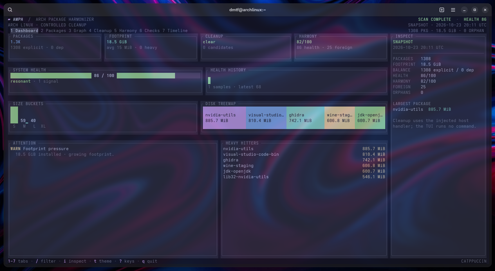
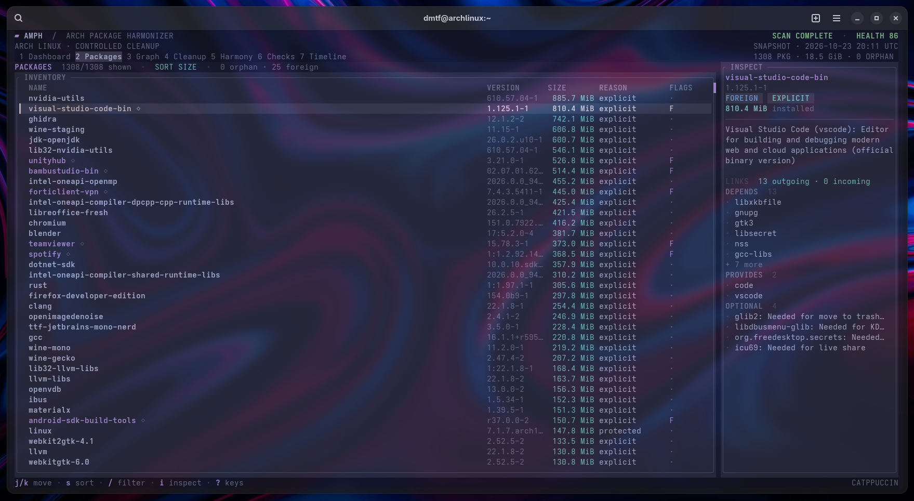
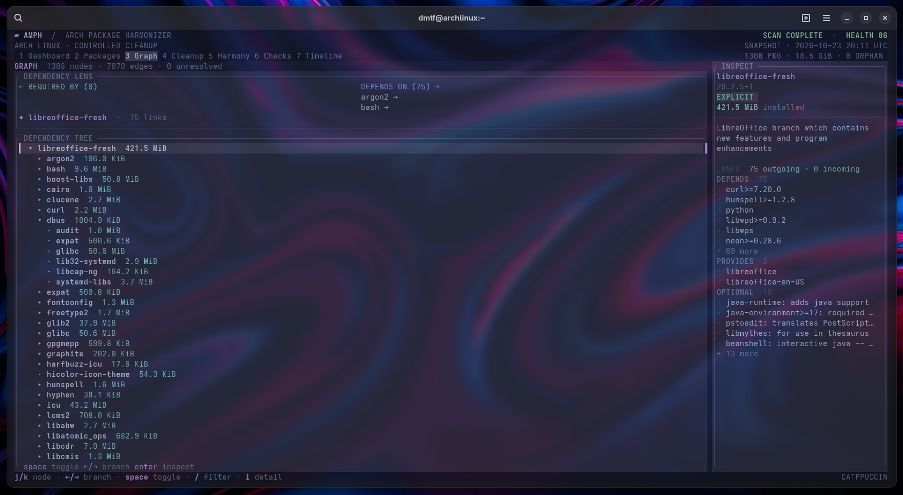
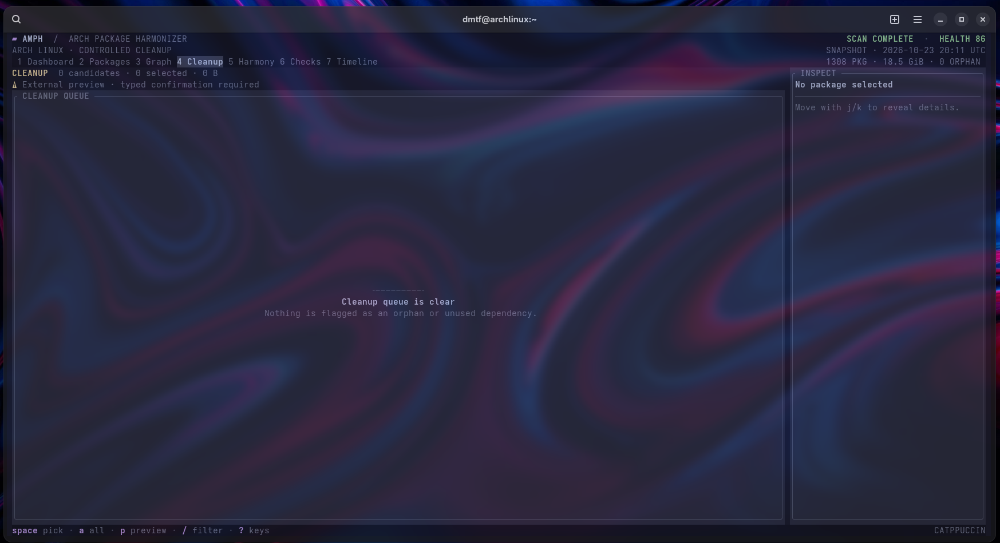
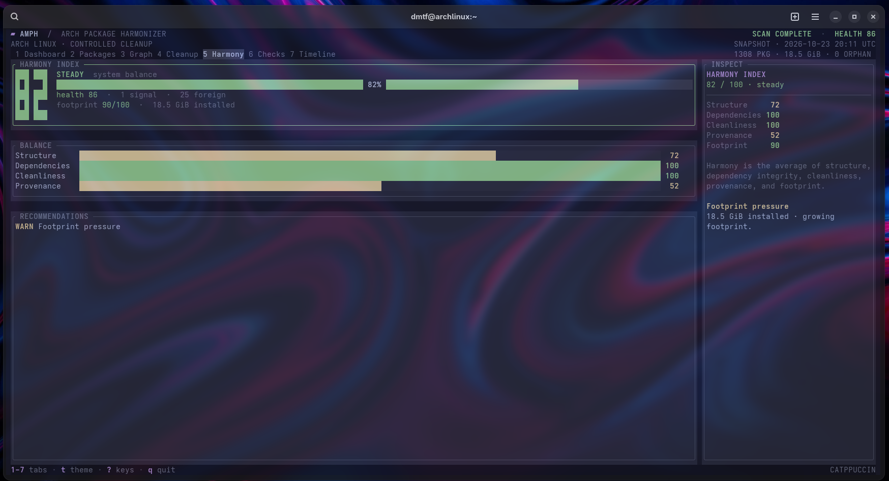
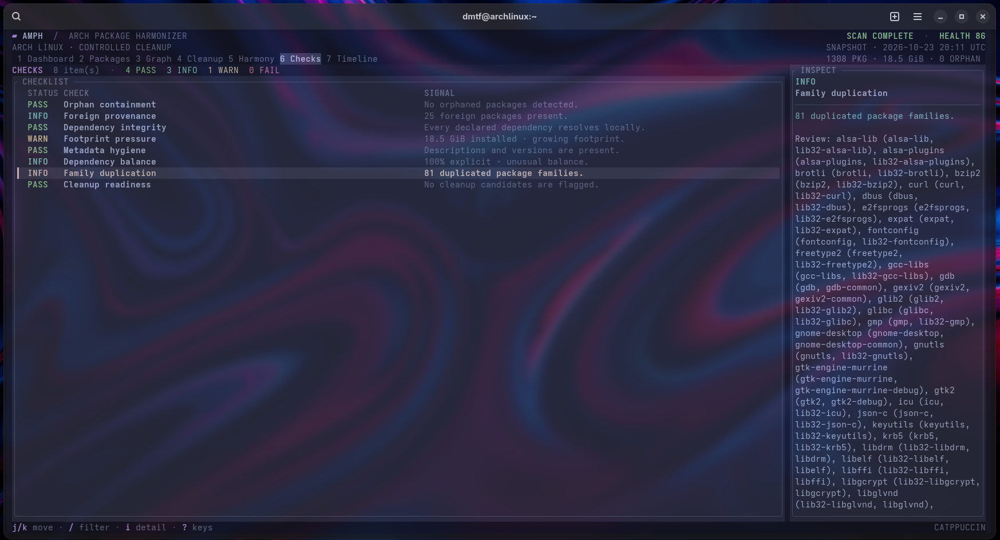
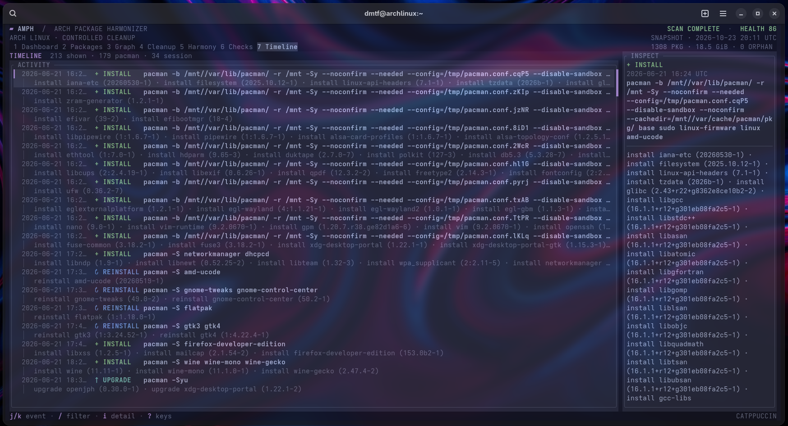
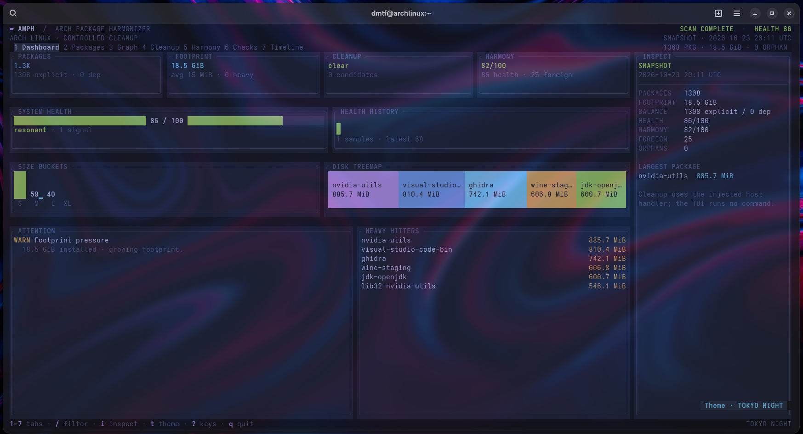
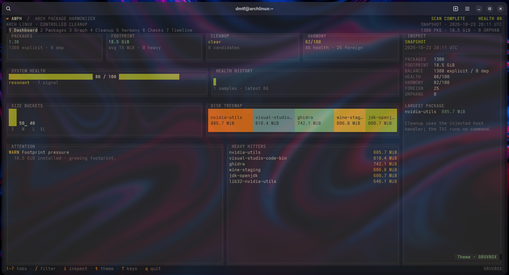
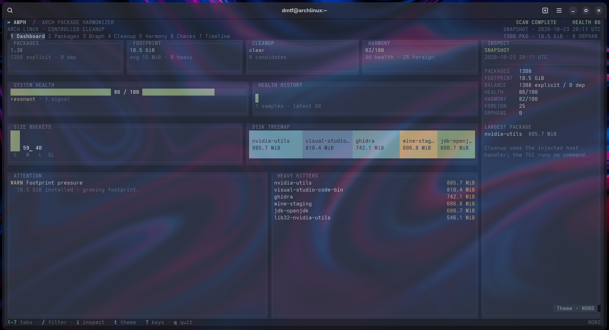

# amph — Arch Meta Package Harmonizer

**v0.2-beta · Arch Linux only**

`amph` helps you understand, maintain and reproduce an Arch package set. It reads pacman's local database directly, resolves dependencies through package `Provides`, and offers a keyboard-driven TUI plus a JSON-friendly CLI. It does not run one `pacman -Qi` process per package.

## Highlights

- **Explore:** package inventory, dependency paths, removal impact and foreign-package detection.
- **Harmonize:** find overlapping tools and get alternatives across package categories.
- **Maintain:** inspect system checks, review pacman history, and preview protected cleanup candidates before confirmation.
- **Reproduce:** export, compare and safely plan declarative TOML blueprints.
- **Automate:** use `--json` output and `amph check` in scripts or cron.

## Screenshots

<table>
  <tr>
    <td align="center"><strong>Dashboard</strong><br></td>
    <td align="center"><strong>Packages</strong><br></td>
  </tr>
  <tr>
    <td align="center"><strong>Dependency graph</strong><br></td>
    <td align="center"><strong>Cleanup</strong><br></td>
  </tr>
  <tr>
    <td align="center"><strong>Harmony</strong><br></td>
    <td align="center"><strong>Checks</strong><br></td>
  </tr>
  <tr>
    <td align="center"><strong>Timeline</strong><br></td>
    <td align="center"><strong>Tokyo Night</strong><br></td>
  </tr>
  <tr>
    <td align="center"><strong>Gruvbox</strong><br></td>
    <td align="center"><strong>Nord</strong><br></td>
  </tr>
</table>

## Install

```sh
cargo build --release --locked
install -Dm755 target/release/amph "$HOME/.cargo/bin/amph"
hash -r
amph --version
```

This user-local install takes precedence over `/usr/local/bin` on the standard Arch `PATH`. For a system-wide install, replace `/usr/local/bin/amph` with the built binary using `sudo install -Dm755 target/release/amph /usr/local/bin/amph`. Or build the Arch package with `makepkg -si`.

## Use

```sh
amph                                  # open the TUI
amph why firefox --json
amph impact firefox chromium --json
amph harmony
amph blueprint export > workstation.toml
amph blueprint diff workstation.toml
amph blueprint apply workstation.toml # plan only; --execute is explicit
amph check --json                     # cron-friendly: 0 healthy, 1 warning, 2 critical
amph timeline --since 7d
amph cleanup                          # preview only
```

Cleanup previews pacman's proposed removal set and requires confirmation to execute. Protected packages (including `base`, `linux` and `pacman`), theme, check thresholds and history retention are configurable in `~/.config/amph/config.toml`:

```toml
protected = ["linux", "pacman", "my-critical-package"]

[theme]
palette = "nord" # catppuccin, tokyo-night, gruvbox, nord

[thresholds]
sync_db_max_age_days = 30
cache_old_days = 30
max_history = 100
```

User Harmony categories live in `~/.config/amph/harmony.toml`.

An optional pacman hook template is installed at `/usr/share/amph/hooks/amph-history.hook`; copy it to `/etc/pacman.d/hooks/` to enable compact post-transaction history recording.

## Verify

```sh
cargo fmt --check
cargo test --locked
cargo clippy --all-targets --all-features -- -D warnings
```

MIT licensed. See [LICENSE](LICENSE).
